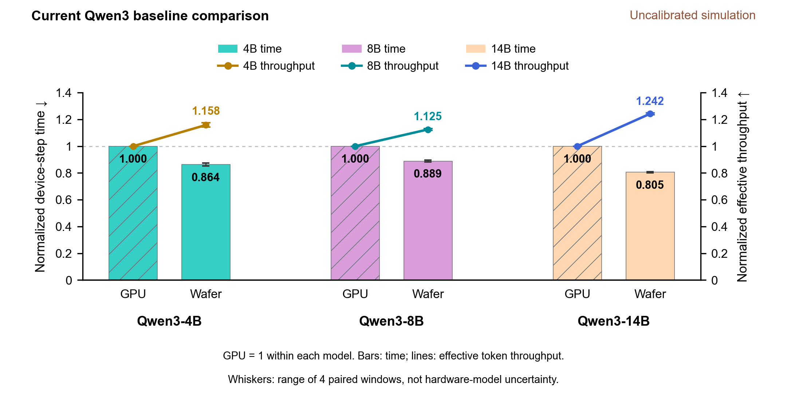

# rl-xy

基于 AstraSim 的 RL post-training 性能仿真框架。当前 f2 分时共置基座包含 Qwen3-4B、8B、14B 的公开长度回放、48×A100 模型以及 48 活动 die 晶圆模型；结果及适用范围见 [f2 结果与接手说明](docs/F2_HANDOFF.md)。

| Qwen3 模型 | GPU test1 / s | 晶圆 test1 / s | GPU 有效 tokens/s | 晶圆有效 tokens/s |
|---|---:|---:|---:|---:|
| 4B | 132.965929 | 159.060157 | 36794.659 | 30758.400 |
| 8B | 178.511874 | 208.237818 | 28248.793 | 24216.279 |
| 14B | 260.754746 | 266.746950 | 16565.670 | 16193.538 |

每点 192 prompts × 8 responses；吞吐为 Σ(P+R)/同步单步时间。这是声明硬件模型下的**单窗口仿真**，不是四窗口均值或实体 48 卡/晶圆端到端计时。GPU 策略由有限网格 Screen 固定，并非硬件全局最优；晶圆仅作容量适配。f2 使用 A100 组件校准，其他 rank 与跨节点通信仍有外推，晶圆没有实体时延校准。

## 历史 0.10.0 结果（不与 f2 混用）

**当前结果尚未完成硬件计时校准，论文性能主结论未放行。** 下表是冻结成本模型的可复算输出。GPU 使用解析 SM/CTA 模型；晶圆使用 core 私有 SRAM 分块和共享带宽模型。成功执行、容量检查与求和一致性不等于已证明真实硬件精度或 GPU 全空间最优。

| 模型 | 平台 | 设备单步时间：均值 ± SD（s） | 有效吞吐（token/s） |
| --- | --- | --- | --- |
| Qwen3-4B | GPU | 234.05 ± 10.41 | 22,084 |
| Qwen3-4B | 晶圆迁移 | 202.11 ± 10.49 | 25,574 |
| Qwen3-8B | GPU | 328.04 ± 17.00 | 16,091 |
| Qwen3-8B | 晶圆迁移 | 291.58 ± 16.51 | 18,103 |
| Qwen3-14B | GPU | 446.03 ± 14.65 | 9,994 |
| Qwen3-14B | 晶圆迁移 | 359.11 ± 11.74 | 12,413 |

每窗口 192 prompt×8 回答，四个正式测试窗口。时间为设备侧完整 RL 单步时间；SD 是窗口负载波动。有效吞吐为四窗口 Σ(P+R)/Σ设备时间，单位 token/s；不同于在线 serving 的请求 TPS。三档每条轨迹均在 GPU—晶圆之间严格配对。



## 从这里开始

| 文档 | 内容 |
|---|---|
| [结果与可靠性](docs/RESULTS.md) | 绝对数值、图、阶段分解、已知问题及历史数据身份 |
| [实验设计](docs/EXPERIMENT_DESIGN.md) | 模型、公开 trace、窗口、策略、硬件与指标的五点设计 |
| [构建与复现](docs/REPRODUCING.md) | 纯 Python 校验、原生后端、单候选与冻结策略配对回放 |
| [架构](docs/ARCHITECTURE.md) | RL 阶段、die/core/tile 粒度、容量、通信和计时口径 |
| [文件索引](docs/FILE_MAP.md) | 实现、脚本、配置与兼容入口职责 |

## 快速核对

```bash
python3 -m pip install -e .
python3 -m unittest discover -s tests -v
python3 scripts/check_public_results.py
python3 scripts/check_qwen3_results.py
python3 scripts/check_docs.py
```

这些命令不需要 GPU。纯 Python 校验检查公开输入、历史结果身份、阶段账本与统计公式；原生小例另见复现文档。完整历史原始日志、编译依赖、模型权重和本地研究工作区不进入本仓库。

```text
公开长度 + 官方模型配置 + 同步协议
  → 分阶段算子/矩阵形状与状态移动
  → GPU SM/CTA 或晶圆 core/tile/容量/带宽成本
  → 原生 AstraSim 网络和依赖执行
  → 阶段完成时间、账本与配对验收
```

自建实现为 MIT。AstraSim、Chakra 及数据/模型元数据使用各自许可；来源和固定 revision 见实验设计与发布数据中的 provenance。0.6 与 0.9.5 的历史小型控制及其原始身份仍保留，不能与当前三档数字混用。

## Idea1 晶圆长尾协作

Qwen3 4B/8B/14B 的融合方案和 test1/test2 仿真结果见 [Idea1 方法与复现入口](docs/IDEA1.md)。
