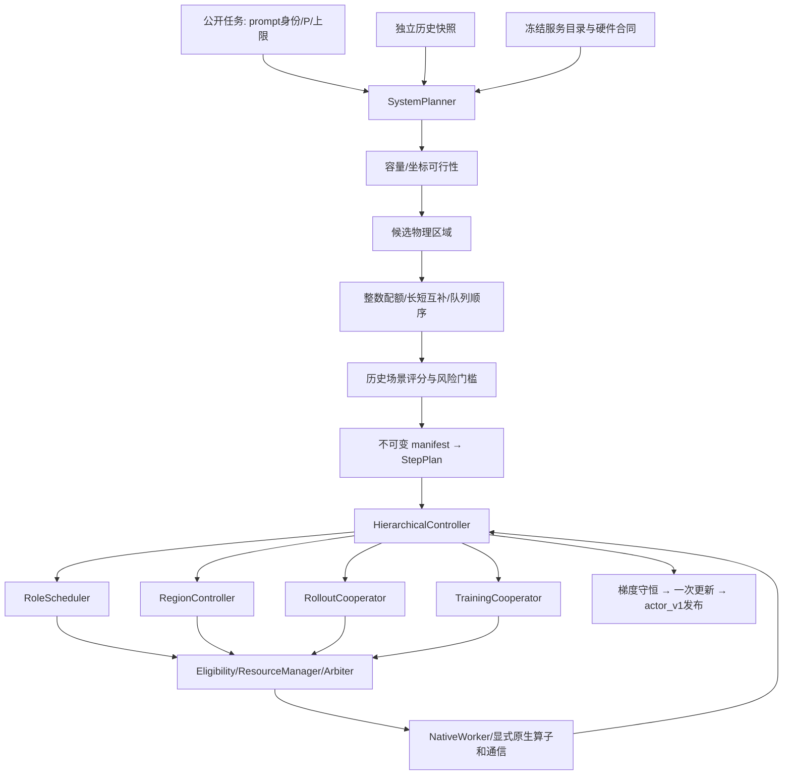

# Idea1：资源规划、历史放置与运行时协作

本实现把三个部分接到同一条可复跑路径：先规划物理资源，再放置任务，最后按实际就绪状态协作。完整数据与原生证据见 [实验入口](../experiments/2026-11-03-idea1-complete/README.md)。此前严格保持旧效果的兼容验收保留在 [IDEA1_LAYERED.md](IDEA1_LAYERED.md)。

这里的结果是固定公开长度 trace 上的单轮原生事件/成本仿真。它覆盖生成、旧策略/参考打分、优势计算、反向、梯度恢复、统一更新和发布；没有执行实际 Transformer 数值计算、奖励评测或学习质量实验。输入、K=8、样本集合和一次全局更新合同保持一致。既有实体硬件和论文性能放行边界没有改变。

## 两个顶层阶段

规划在原生执行后端启动之前完成。`SystemPlanner`接收公开任务视图、绑定身份的历史快照、冻结算子服务目录，输出不可变 manifest。`SelectedManifestPlanner`将它绑定到框架 `StepPlan`，检查模型坐标、任务、容量、版本与执行后端能力。运行时不在每个 RPC 内重新搜索布局。



旧整体 `NativeKernel.step()` 保持禁用；调用会报错。原生回调经过角色、区域、协作候选、检查、仲裁和 Worker。底层继续复用冻结算子与原生通信，并非把旧整体调度函数包一层调用。

## 分层实现与入口

| 层次 | 责任 | 实现 |
|---|---|---|
| 启动与复跑 | 输入身份、公共视图、准备/执行边界、命令/退出证据 | [run_system.py](../scripts/idea1_layered/run_system.py) |
| 资源与状态规划 | 并发容量、可用TP、物理区域、actor视图和状态生命周期 | [system.py](../src/idea1_controller/system.py)、[lifecycle_memory.py](../src/idea1_controller/lifecycle_memory.py)、[actor_views.py](../src/idea1_controller/actor_views.py) |
| 物理布局 | 54 die精确覆盖，TP2/4/8训练区域、AR物理环 | [physical_layouts.py](../src/idea1_controller/physical_layouts.py)、[topology.py](../src/idea1_controller/topology.py) |
| 历史与任务放置 | 历史绑定、整数配额、长任务跨域分散、域内短任务保留、队列顺序 | [history.py](../src/idea1_controller/history.py)、[quotas.py](../src/idea1_controller/quotas.py)、[assignment_v2.py](../src/idea1_controller/assignment_v2.py) |
| 场景与选择 | 历史场景服务估计、风险/压力门槛和基准回退 | [search_views.py](../src/idea1_controller/search_views.py)、[scenario_runtime.py](../src/idea1_controller/scenario_runtime.py)、[pool_search.py](../src/idea1_controller/pool_search.py) |
| 运行时控制 | 角色、实际区域退出、数据等待、跨TP唤醒和完成屏障 | [orchestration.py](../src/idea1_controller/orchestration.py)、[regions.py](../src/idea1_controller/native/regions.py)、[selected_context.py](../src/idea1_controller/native/selected_context.py) |
| 推理协作 | 未开始回答接管、KV收费迁移、attention与FFN协作 | [packed_pending.py](../src/idea1_controller/native/packed_pending.py)、[full_layer.py](../src/idea1_controller/native/full_layer.py)、[view_migration.py](../src/idea1_controller/native/view_migration.py) |
| 训练协作 | 原生run/skip票据、未开始微批转出、容量约束TP2执行 | [region_training_help.py](../src/idea1_controller/native/region_training_help.py) |
| 梯度与发布 | 参数坐标、显式恢复、原owner规约、一次更新与发布 | [coordinates.py](../src/idea1_controller/coordinates.py)、[gradient_protocol.py](../src/idea1_controller/native/gradient_protocol.py)、[backend.py](../src/idea1_controller/native/backend.py) |
| 独立检查 | 样本、版本、真实物理分组、内存、字节量、程序哈希、原生事件 | [audit_idea1_system.py](../scripts/audit_idea1_system.py)、[profile_idea1_system.py](../scripts/profile_idea1_system.py) |

规划模块可独立导入，不依赖 native legacy 模块。启动入口只保留完整系统、原生执行后端、旧策略兼容复跑三个驱动。开发过程的中间驱动不作为当前公共入口。

## 阶段一：确定资源和物理分布

当前执行底座是27个相邻 TP2 推理实例，覆盖54 die。每个实例的 actor BF16分配同时提供训练和推理的规范坐标视图；不再另行物化相同的 rollout 权重副本。生成阶段不保留无用梯度，训练阶段按实际TP分配紧凑梯度和激活，激活释放后再恢复原TP2梯度。

容量准入使用公开prompt长度和8192回答上限，不使用当前真实回答长度。训练微批在EOS已观测后按实际长度检查，必要时逐次减半到1。绑定目录检查模型配置、硬件、数学来源、compute/network scale，拒绝把不匹配的服务预测用于规划。

资源搜索范围为当前后端支持的族：固定TP2推理底座，矩形 TP2/4/8 训练区域可混合。DP区域数与物理成员共同变化，54 die的余数不丢弃。另有“较大协作域内保留多个TP2训练副本”的候选族；六die协作域不被称作或执行成TP6训练副本。

推理TP1在至少达到当前总并发的比较条件下给出容量下界拒绝证据。当前没有TP1或TP4/8推理执行适配器，也不支持非均匀TP6；因此不能把本次选择称为所有TP/布局的全局最优。训练采用不同TP，不改变原TP2分布式优化器owner的位置与序号。只有可交换SUM AR的物理环允许重排，RS/AG的owner顺序固定。

## 阶段二：决定任务放置

同任务历史绑定模型配置、prompt SHA、prompt长度和library。公开trace提供的是独立回答，当前使用不与任何评估样本重叠的64个历史回答，组成8个伪轮次；它不是连续actor更新的真实历史。没有足够历史时采用合法基准放置。

192个prompt组不能均匀除以27。先按区域份额分配整数配额，再分给区域内实例，保留全部192×8回答，不补样本、不删样本。按历史识别的长组跨域分散，在域内保留较短邻居，尝试让它们先释放并协作；同时比较原队列顺序与历史长任务优先启动。以完整单轮服务估计评分，不能仅最小化各实例负载差。

候选以16个历史场景、尾部风险、8192压力场景和规划开销作门槛检查；收益不明确时保留基准。近似模型不包含所有原生竞争和运行时训练借算影响，最终选择仍需原生TUNE验证。最终测试固定TUNE选出的物理布局与容量；每个窗口仍按其公共任务与独立历史重新放置，测试真实R不进入规划接口。冷布局搜索、一次性目录构建和热放置规划分别记账。

## 阶段三：运行时协作和训练接管

`assigned_role`只表示推理或训练；`activity`独立记录OWN、HELP、TRANSFER或WAIT。训练借算保持TRAINING角色，临时执行组变为相应TP2执行对，并记录租约。

1. 在原生安全点，空闲实例先接收同域未开始的回答。源实例优先填满自身正常并发，避免回答来回转移；只移动prompt/元数据，不迁移该回答尚不存在的KV。
2. 按历史条件剩余长度和收费收益决定是否帮助长尾。attention和FFN均执行协作，最终采样/输出仍由源实例完成。helper权重是本地actor子视图，只迁移需要的KV；所有读、pack、P2P、写、unpack和后续通信收费。租约保留到这批活动回答退出。
3. 区域全部退出推理并释放租约后，进入DATA_WAIT；收齐完整训练组数据才唤醒全部物理TP成员，执行old/reference、优势、梯度清零和反向。设备退出与数据就绪是两个条件。
4. 源区域在同步点发布原生run/skip票据。被转出的微批不会由某个TP follower误执行。未开始微批可从TP2/4/8区域转出，完成自身训练与TP2梯度恢复的执行对按可容纳的小微批顺序执行；不重新清零其已有梯度，不迁移在途激活。只有预计收费后获益才接管。
5. `region-ready`准入只检查源/接收区域就绪，不必等待无关区域生成结束。`global-eos`保留为严格对照开关。独立小例验证了其他区域仍在生成时发生训练接管；本轮TUNE完整窗口该开关的设备时序相同，不能将其宣称为这些窗口的加速来源。

## 阶段四：恢复、统一更新和发布

Q/K/V、gate/up/down、行并行列切片、共享embedding和norm的坐标分别描述。TPp梯度显式扩展/重排到原TP2坐标；Q/K norm的partial相加，equal副本不重复相加，非贡献DP缓冲与padding明确清零。训练借算写入接收方已恢复的TP2梯度，由原全局SUM纳入一次，不回传或重复计算贡献。

原静态原生后缀等待全部动态序列完成，再执行固定owner的梯度规约、一次优化器更新和actor参数发布。actor_v0旧读者全部退出后才发布actor_v1，reference仍为v0。符号坐标/样本守恒和原生时序检查不能替代真实BF16 Transformer梯度与学习质量验证。

## 复跑和审计

先按[旧分层复跑说明](IDEA1_LAYERED.md#复跑)构建指定原生后端并准备small/14B两个冻结成本工作区。完整系统输入由以下入口准备：

```bash
python scripts/prepare_idea1_system.py --model 14B --output /tmp/idea1-input-14b
PYTHONPATH=/tmp/layered-cost-14b/src python scripts/idea1_layered/run_system.py \
  --model 14B --window test1 --output /tmp/idea1-complete-14b \
  --layout-from experiments/2026-11-03-idea1-complete/assets/layout-14B.json \
  --history /tmp/idea1-input-14b/history.json --allow-offline-history-proxy \
  --catalog /tmp/idea1-input-14b/catalog.json \
  --fast-cost-validation /tmp/idea1-input-14b/cost-backend-validation.json \
  --native-root "$ASTRA_SIM_ROOT"
python scripts/audit_idea1_system.py /tmp/idea1-complete-14b/native-run --output /tmp/idea1-complete-14b/audit.json
```

4B/8B使用small成本工作区，14B使用14B成本工作区。输出目录必须不存在。不传`--layout-from`会重新搜索区域；`--resource-family pooled-tp2`搜索协作域族；`--plan-only`只准备不可变计划。使用原始lengths.csv.gz可在准备入口加`--history-source`重新导入历史。

可选C++后端只加速主机上的冻结FIFO成本查询；与Python参考的所有返回字段检查一致，原187数学/配置文件与原生ASTRA没有因此改动。它不构成设备性能收益。原生执行、已执行程序哈希、54rank issue/callback、阶段容量证书和样本/梯度合同独立验收；完整命令、退出状态和压缩原始证据随实验保存。

当前最小借算粒度是TP2执行对，训练原始宏微批转给一个执行对后顺序拆分。未实现宏微批跨多个执行对并发拆分、在途激活迁移、跨actor版本预测校准或GPU同机制对照。这些边界和后续瓶颈见实验报告，不用“保持所有die忙碌”替代完整关键路径优化。
