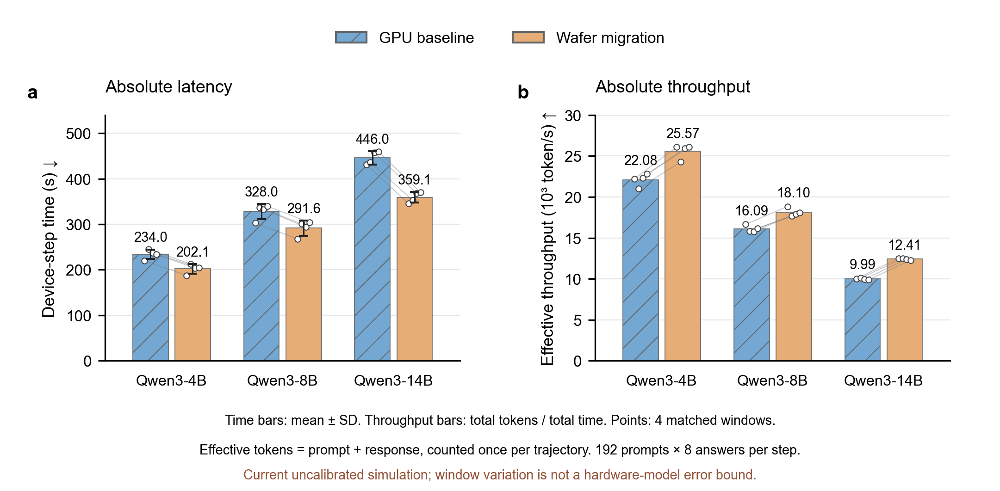

# 当前结果与证据边界

## Qwen3 三档：冻结模型输出

本页展示 2026-10-28—29 执行的 24 个正式仿真（12 个配对窗口）。后续可靠性核查保留全部原始数字，但撤回其论文性能主结论放行。发布整理没有重新执行完整矩阵，也没有将当前 Git commit 回填为历史运行源码。

| 模型 | 平台 | 设备单步时间：均值 ± SD（s） | 有效吞吐（token/s） |
| --- | --- | --- | --- |
| Qwen3-4B | GPU | 234.05 ± 10.41 | 22,084 |
| Qwen3-4B | 晶圆迁移 | 202.11 ± 10.49 | 25,574 |
| Qwen3-8B | GPU | 328.04 ± 17.00 | 16,091 |
| Qwen3-8B | 晶圆迁移 | 291.58 ± 16.51 | 18,103 |
| Qwen3-14B | GPU | 446.03 ± 14.65 | 9,994 |
| Qwen3-14B | 晶圆迁移 | 359.11 ± 11.74 | 12,413 |

有效吞吐＝四窗口输入与输出 token 总数／四窗口设备总时间。每窗口 1536 条轨迹；SD 是四窗口样本标准差，不是硬件预测误差。不同模型的回答长度不同，跨平台增益应在同模型内计算。


参照 WSC-LLM Fig.11 的柱线组合风格；这里两项均以各模型 GPU＝1 归一化，双轴尺度相同。须线是四个配对窗口比值的最小—最大范围。本文吞吐为有效 token/s，原论文 TPS 为请求/s，不能混称。相同 token 工作量下，时间与吞吐互为倒数，不是独立性能证据。



时间柱为均值±SD；吞吐柱为总 token/总时间。空心点及连接线保留全部四个配对窗口。可编辑 SVG、矢量 PDF 与 PNG 均在 [figures](../experiments/2026-10-29-qwen3/figures)。

## 为什么总时间更低

| 模型 | 生成：晶圆−GPU（s） | old/ref logprob（s） | 训练（s） | 整步：晶圆−GPU（s） |
|---|---:|---:|---:|---:|
| 8B | +15.059 | −18.527 | −32.795 | −36.465 |
| 14B | +6.489 | −33.898 | −59.190 | −86.922 |

当前模型中，晶圆训练计算时间反而更长，访存和通信/同步等待更少；8B 的生成并发还从64降至32。账本能解释加法关系，不能替代硬件验证。原始阶段数据见 [formal_phases.csv](../experiments/2026-10-29-qwen3/formal_phases.csv)，成本分解与问题见 [reliability.json](../experiments/2026-10-29-qwen3/reliability.json)。

## 仍然存在的问题

- GPU 忽略跨 CTA 的 L2 复用、采用有限 CTA 候选和单 CTA/SM，并将本地计算与访存相加，可能高估训练/logprob 时间。
- 晶圆 BF16 速率沿用论文 FP16、SRAM/向量带宽及 D2D 时间口径含未校准假设。每 core SRAM 容量有论文来源，不代表带宽时间准确。
- 原 C≤64 搜索不是充分优化证明。后续 C128 探针获得约0.32%–2.41%的模型内调优改善；这些诊断未混入此处四窗口均值。
- 没有量化可信的硬件模型误差区间，也没有数值训练、学习质量或同晶圆专用方法的收益证据。不能预设“直接迁移必须慢于GPU”，也不能据现有数值断言硬件优势成立。

## 身份与独立复算

- 历史成本/执行源码树：`d7530f67e57de75cbcbfd4fc518bfb5cb6f738bdc3f895eb0014cee18bfb45ad`；基准 Git：`0ced6aad4eb818e8722f04500b1ea0e39fb26719`。
- 固定 AstraSim：`4ce9ecfe746a3ee5fe47559a11d91644d641fa7f`；历史二进制 SHA 见 [provenance.json](../experiments/2026-10-29-qwen3/provenance.json)。
- 当前公开包装器增加可移植路径、校验与回放入口，属于后续源码身份。关键数学成本文件与历史 SHA 对照由检查器报告；不会追认新源码曾运行过完整旧矩阵。

```bash
python3 scripts/check_qwen3_results.py
```

检查公开的原输入/结果 SHA、24 个配对轨迹身份、216 个阶段、时间均值/SD和有效吞吐。公开包包含记录的 result/账本与原 manifest 身份，未包含完整原生事件日志；该命令不声称原始日志重放或硬件校准。数据索引：[汇总](../experiments/2026-10-29-qwen3/summary.csv)、[逐窗口](../experiments/2026-10-29-qwen3/window_metrics.csv)、[配对增益](../experiments/2026-10-29-qwen3/paired_comparison.csv)、[原输入](../experiments/2026-10-29-qwen3/inputs)。

## 历史 3B 控制

0.9.5 的 Qwen2.5-3B、384×8、P512/R128 固定长度控制时间为 GPU16.503234s、晶圆19.176605s。它使用旧输入、协议/执行身份和热 GEMM 标签，不能与 Qwen3 公开长度回放混为同一主表。完整历史轻量证据继续保留在 [0.9.5](../experiments/2026-10-28-v0.9.5) 与 [0.6](../experiments/2026-10-27-v0.6)，由 `check_public_results.py` 按原身份检查。
