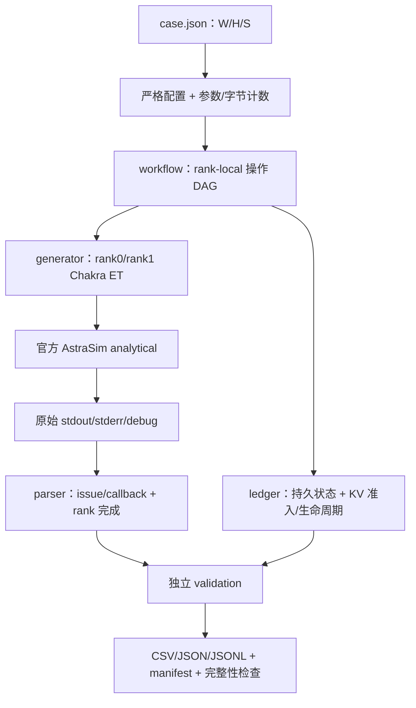

# rl-xy：仿真器搭建、逐文件说明与完整流程

交付日期：2026-10-26（Asia/Shanghai）。本报告由实际通过的 Docker/AstraSim 验收包生成。

## 1. 本次搭建结果

服务器工程根目录：`/path/to/research/rl-xy`；容器：`rl-xy`；容器内目录：`/workspace/rl-xy`。

已经跑通配置→细粒度操作图→每 rank Chakra ET→官方 AstraSim→日志配对→独立检查→带哈希结果包的完整链路。
当前交付定位是两 die TP=2 的同步 GRPO 操作级合成回放基础版，包含单轮与两轮；大模型前后向、采样和 AdamW 不做数值张量计算。

| 验收场景 | AstraSim 总时间 / model ns | 逻辑操作 | 参与 rank 节点 | 检查 |
|---|---:|---:|---:|---:|
| transfer | 21.000 | 9 | 10 | 7/7 |
| toy | 100264.270 | 460 | 911 | 37/37 |
| two_rounds | 200528.540 | 920 | 1822 | 59/59 |
| toy_repeat | 100264.270 | 460 | 911 | 37/37 |

全部 CLI/完整性检查退出码均为0。重复单轮的 events.jsonl 逐字节一致；两轮 actor v0→v1→v2，Reference v0 保持冻结。
单元测试实际日志：`Ran 34 tests in 0.314s`，最终 OK；总验收断言 8 项全部通过。
总验收报告：`acceptance/baseline-20261026-release/report.json`，保留每条命令、退出码、日志路径和日志 SHA-256。

## 2. 环境和版本

| 项目 | 本次值 |
|---|---|
| 项目镜像引用 | `rlxy-astrasim:0.1.0` |
| 不可变镜像 ID | `sha256:32b6bd903647cd2817bcadacb5bcb863470cec45a687d6a9d18bdc883817b9dd` |
| 官方 AstraSim commit | `4ce9ecfe746a3ee5fe47559a11d91644d641fa7f` |
| AstraSim binary SHA-256 | `a973390a6d73eaf5814ee290129d2bcb2f1fbaaa55447f4762f898774789ddb7` |
| 本次源码树 SHA-256 | `481e29f4cfd7f6d298bacd791f2ebe1a13ff3546402d025ba94ee15484937f6e` |
| Python | 3.12.3 |
| 基础镜像 | pjlab/deeplearning:v2.2.3-cuda12.8.0-torch2.7.0；宿主已有镜像 |
| 工具链 | Abseil 20240722.0、Protobuf C++29.0 / Python5.29.0 |
| 时序后端 | AstraSim_Analytical_Congestion_Unaware |
| 模拟设备 | 2 die × 1 logical core；TP2/PP1/DP1 |
| 初始化边界 | 参数/优化器/梯度缓冲在 t=0 已初始化；测量稳态轮次 |

未自动提交或推送 Git；git revision 为 null 时，以本次 manifest 的源码树 SHA-256 定位运行内容。基础镜像不等于模拟硬件；仿真没有占用 GPU。
源码树 hash 覆盖源码、配置、测试、脚本和手写文档；排除本页及 HTML 预览这两个派生报告，避免报告引用自身 hash 的循环定义，也排除缓存及运行产物。验收另行检查四次运行的 hash 均与当前源码一致。

## 3. 架构与各层职责



W 定义模型、token、group、reward、损失分母和版本；H 定义容量与合成速率；S 定义 TP 布局、微批和严格同步顺序。AstraSim 负责实际时间推进，外层不补造缺失时序。
rank0 独占的输入、采样、reward 和 advantage 不在 rank1 镜像。每 rank 只依赖自己前一个本地节点；P2P/collective 将本地链同步。

## 4. 所有自建文件逐一说明

本节逐项覆盖 60 个自建文件。第三方 .deps/.git、缓存和重复 run 文件不作为自建源码；其作用分别见第9节和结果目录清单。

| 文件（相对于工程根） | 职责、输入/输出及使用时机 |
|---|---|
| `.dockerignore` | 限制 Docker build context；排除依赖缓存、历史运行结果、构建日志和验收包。 |
| `.gitignore` | 区分源码与可再生文件；排除 .deps、缓存、运行结果、验收包和构建日志。 |
| `LICENSE` | 自建工程的 MIT 许可证；上游 AstraSim/Chakra 仍遵守各自许可证。 |
| `Makefile` | Docker 脚本的快捷入口；提供 build、test、transfer、toy、two-rounds、all。 |
| `README.md` | 工程总入口、最小例子、运行命令、证据边界与文档导航。 |
| `compose.yaml` | 可选 Compose 构建/交互声明；正式结果使用 docker.sh 保留镜像身份。 |
| `configs/fixture_transfer/astra_network.yml` | 两 rank FullyConnected；精确表达放大 1000 倍后的带宽与链路时延。 |
| `configs/fixture_transfer/astra_remote_memory.json` | 固定 NO_MEMORY_EXPANSION；禁止隐式借用远程内存。 |
| `configs/fixture_transfer/astra_system.json` | FIFO/native ring、trace 开关、零额外 endpoint/reduction delay 和后端设置。 |
| `configs/fixture_transfer/case.json` | 该案例的工作负载、硬件、策略与合成成本合同；CLI 的主输入。 |
| `configs/toy_grpo_2die/astra_network.yml` | 两 rank FullyConnected；精确表达放大 1000 倍后的带宽与链路时延。 |
| `configs/toy_grpo_2die/astra_remote_memory.json` | 固定 NO_MEMORY_EXPANSION；禁止隐式借用远程内存。 |
| `configs/toy_grpo_2die/astra_system.json` | FIFO/native ring、trace 开关、零额外 endpoint/reduction delay 和后端设置。 |
| `configs/toy_grpo_2die/case.json` | 该案例的工作负载、硬件、策略与合成成本合同；CLI 的主输入。 |
| `docker/Dockerfile` | 基于指定本地镜像构建 Abseil、Protobuf、固定 AstraSim 和隔离 Python 环境。 |
| `docs/ARCHITECTURE.md` | W/H/S 分层、模块边界、rank-local DAG、时间编码与当前扩展边界。 |
| `docs/EVIDENCE_BOUNDARIES.md` | 区分合成回放、解析假设、硬件校准和真实训练；规定指标可支持的结论。 |
| `docs/REPRODUCIBILITY.md` | 环境、执行顺序、结果包、hash 复查和失败后的复现规则。 |
| `docs/components/astra_adapter.md` | Chakra 映射、官方 CLI、单位、日志契约及 SEND/RECV 口径。 |
| `docs/components/config.md` | 配置组件的输入、输出、字段约束和失败条件。 |
| `docs/components/docker.md` | 指定基础镜像、独立 venv、项目持久容器、临时代理和正式运行说明。 |
| `docs/components/ledger.md` | storage 和 KV 容量账本的字段、公式、释放规则及覆盖范围。 |
| `docs/components/reporting.md` | run bundle 每类产物、指标定义、来源和哈希/状态约束。 |
| `docs/components/validation.md` | 独立验收项、fail-closed 行为、手算链路和负例要求。 |
| `docs/components/workload.md` | 工作流组件的阶段、操作、采样/TP/损失/反向与版本语义。 |
| `docs/完整流程预览.html` | 本文的轻量预览：运行结果、12 阶段流程、阶段时间与文件清单。 |
| `docs/工程文件与完整流程.md` | 本文：全部自建文件索引、完整案例、实际阶段时间、复现入口及结果解释。 |
| `examples/toy_grpo_2die/README.md` | 教学例子的模型、两条轨迹、参数/KV/版本公式和逐步使用说明。 |
| `pyproject.toml` | Python 包名/版本/依赖、src 布局及 rlxy CLI 注册。 |
| `scripts/acceptance.py` | 依次执行容器测试、链路、单轮、两轮、重复运行和完整性门禁，保存命令日志。 |
| `scripts/check_result.py` | 复查成功状态、非空检查集、固定上游版本、Docker 证据和全部文件 SHA-256。 |
| `scripts/docker.sh` | 无 sudo 的 Docker build/create/exec/run 统一入口；核验挂载、UID/GID、镜像 ID。 |
| `scripts/write_walkthrough.py` | 读取 PASS 验收包生成本文及 HTML 预览；逐文件说明缺项时立即失败。 |
| `src/rl_xy/__init__.py` | Python 包入口与包版本。 |
| `src/rl_xy/astra_adapter/__init__.py` | 公开配置核验、trace 生成、进程执行、日志解析的边界接口。 |
| `src/rl_xy/astra_adapter/config.py` | 交叉核验 system/network/remote-memory 与 case 的 rank、时间及带宽单位。 |
| `src/rl_xy/astra_adapter/generator.py` | 生成每 rank 的官方 Chakra ET；验证节点、tag、参与者、本地依赖和 collective。 |
| `src/rl_xy/astra_adapter/parser.py` | 配对 issue/callback，核验节点类型、所有 rank 完成与统计，不接受残缺结果。 |
| `src/rl_xy/astra_adapter/runner.py` | 核验官方 commit 和可执行文件；无 shell 调用 AstraSim，保存命令与原始日志。 |
| `src/rl_xy/cli.py` | argparse 单入口；run 执行 toy，fixture-transfer 执行链路测试。 |
| `src/rl_xy/config.py` | 严格读取 case JSON；拒绝未知字段、类型漂移及不支持的并行/学习合同。 |
| `src/rl_xy/costs.py` | 声明的 FLOP/vector 合成成本；保留局部 DMA 公式；无硬件实测校准。 |
| `src/rl_xy/fixture.py` | 独立的 21 ns 数据移动链、out-of-place SRAM 分配与 63 B 容量负例。 |
| `src/rl_xy/ledger.py` | 参数/优化器/梯度持久 storage 与 rollout KV 的身份、生命周期和准入容量账。 |
| `src/rl_xy/model.py` | 枚举 Transformer 参数分片/复制、各状态字节及每 token KV 字节。 |
| `src/rl_xy/reporting.py` | 写 CSV/JSON/JSONL、round.phase 时间、指标、SUMMARY 与 hash manifest。 |
| `src/rl_xy/run.py` | 串接配置复制、trace、AstraSim 执行、解析、账本检查及成功/失败归档。 |
| `src/rl_xy/types.py` | 配置、Operation、ObjectRecord、MemorySnapshot、AstraEvent、CheckResult 等共享类型。 |
| `src/rl_xy/validation.py` | 从独立清单核对阶段、反向、清零、Adam 读写、版本、KV、通信与真实事件。 |
| `src/rl_xy/workflow.py` | 将同步 GRPO 展开成 rank-local DAG，显式生成 TP、采样、损失反向和版本节点。 |
| `tests/test_astra_config.py` | 带宽缩放/两套配置正例，带宽漂移和 bool 冒充整数负例。 |
| `tests/test_check_result.py` | 完整 bundle 校验正例，以及篡改 metrics 后拒绝的负例。 |
| `tests/test_config_model.py` | 参数/KV 手算、未知字段、证据等级、策略字段和 rounds 覆盖测试。 |
| `tests/test_fixture.py` | T01 结构/容量手算与 63 B out-of-place 不可行负例。 |
| `tests/test_generator_contract.py` | P2P 参与者错误、tag 越界、不支持 collective 的 fail-closed 测试。 |
| `tests/test_ledger.py` | 长期状态、KV reservation/materialization、NIC 计划容量及两轮无泄漏检查。 |
| `tests/test_parser.py` | 事件配对、缺 callback、乱序日志、rank-local 节点和提前 RECV 等待测试。 |
| `tests/test_reporting.py` | 两轮 phase 不混桶，以及空参数表仍有固定 CSV schema。 |
| `tests/test_validation.py` | 完整证据正例；删依赖、漏反向/Adam 状态、容量越界/漏事件等负例。 |
| `tests/test_workflow.py` | 本地依赖链、完整前后向、embedding TP 求和、梯度清零及 v2 发布。 |

## 5. 完整例子的 W/H/S 合同

模型为2层微型 Transformer：hidden8、query/KV heads2/2、head_dim4、FFN16、vocab16、RMSNorm/SwiGLU、无 bias、词嵌入和输出头不绑权。Actor/Reference/KV 为BF16；master/gradient/Adam m/v为FP32。
输入 prompt=[1,2]；A response=[3,4,5]、reward=1；B response=[6,7]、reward=0。最后生成的 token 不再送回前向，因此 rollout/Reference/old/训练前向各处理7个输入位置；回答概率和损失覆盖5个位置。
训练微批为单条轨迹；A、B 都使用同一个全局损失分母5，累积后只做一次裁剪/更新。max_response=3 是公开准入上界；固定 A/B/stage 顺序不按未来真实长度优先排序。

| 参数/状态 | 每 die 数量或字节 |
|---|---:|
| 唯一逻辑参数 | 全模型1576个 |
| 每 die 本地参数 | 808个（含复制 norm 参数） |
| Actor BF16 / Reference BF16 | 1616 / 1616 B |
| master / Adam m / Adam v | 各3232 B |
| 长期状态 | 12928 B |
| FP32 梯度累积缓冲 | 3232 B |
| 常驻状态与梯度合计 | 16160 B |
| 每个已处理 token 的本地 KV | 32 B |
| 两轨迹 KV 准入预留 | 256 B |
| rollout KV 实际峰值 / 每轮累计写入 | 192 / 224 B |

两个回答可同时保留 KV，计算共享同一 TP2 组按固定顺序运行。KV 曲线为0→128→192→96→128→0；B 结束时，B 已物化存储和未兑现预留一起释放。

## 6. 一轮实际发生的12个阶段


| 阶段 | 完整数据/控制流 |
|---|---|
| 输入 / `input` | host 将 prompt [1,2] 送入 D0，再通过 P2P 复制到 D1。 |
| 生成 / `rollout` | A/B 各 prefill 两 token，随后 A1/B1 decode、释放 B KV，再 decode A2、释放 A KV。D1 logits 发给 D0，由 D0 采样并广播 token。 |
| 奖励 / `reward` | 已完成回答送回 host；固定规则奖励 A=1、B=0，并向 D1 发送奖励结果和阶段围栏。 |
| Reference 概率 / `reference` | 冻结 Reference 对 A/B 的 teacher-forcing 输入执行前向，取 3/2 个回答位置的 log-prob。 |
| 旧策略概率 / `old_policy` | 更新前 actor v0 对同一 A/B 输入执行无梯度前向，输出 old log-prob。 |
| 组内优势 / `advantage` | 组均值为0.5，A/B 优势为+0.5/-0.5；D0 将结果复制给 D1。 |
| 训练 A / `train_A` | 先清零本轮 FP32 梯度缓冲；执行 A 的前向、全局分母5的损失、损失到 logits 的反向、模型反向及梯度累积。 |
| 训练 B / `train_B` | 执行 B 的同类前后向并累积到同一梯度缓冲；B 不会再次清零。 |
| 梯度裁剪 / `clip` | 分片贡献局部平方和；复制 norm 参数由 owner 贡献；标量 AllReduce 后应用裁剪。 |
| 优化器 / `optimizer` | shape-only AdamW 读取 gradient/master/m/v，写 master/m/v/actor；Reference 不写。 |
| 发布 / `publish` | 全分片小 payload AllReduce 围栏后发布 actor v1；publish marker 显式为1 ns。 |
| 回收 / `cleanup` | 记录本轮临时 KV 已释放；cleanup marker 显式为1 ns；下一轮从新 actor 版本继续。 |

每次前向都展开 embedding→embedding TP 求和→每层 norm/QKV/attention score/softmax/AV/O projection/TP 求和/residual/norm/gate-up/SwiGLU/down/TP 求和/residual→final norm→LM head。
概率阶段保持词表分片，对目标位置执行 max、sum-exp 和 target-logit 三次 AllReduce。反向展开 loss→logits gradient→LM head dinput/dweight→TP input-gradient 求和→final norm backward→逆层序 FFN/attention/QKV/norm backward→embedding backward→gradient RMW。
DP=1，因此没有 DP 梯度 AllReduce。发布围栏使用4 B的 native AllReduce；publish/cleanup 各1 ns为显式控制 fixture。

### 本次单轮阶段时间

下面由真实 issue/callback 取各阶段最早 issue 与最晚 callback，再除以1000。单位 model ns；通信驻留可能含 posted RECV 等待。

| 阶段 | 起点 / ns | 终点 / ns | 跨度 / ns | 节点数（含参与rank） |
|---|---:|---:|---:|---:|
| 输入 | 0.000 | 5.000 | 5.000 | 3 |
| 生成 | 5.000 | 14569.530 | 14564.530 | 345 |
| 奖励 | 14569.530 | 14588.530 | 19.000 | 4 |
| Reference 概率 | 14588.530 | 28324.075 | 13735.545 | 144 |
| 旧策略概率 | 28324.075 | 42059.620 | 13735.545 | 144 |
| 组内优势 | 42059.620 | 42069.620 | 10.000 | 3 |
| 训练 A | 42069.620 | 68324.210 | 26254.590 | 128 |
| 训练 B | 68324.210 | 87329.270 | 19005.060 | 126 |
| 梯度裁剪 | 87329.270 | 90563.770 | 3234.500 | 6 |
| 优化器 | 90563.770 | 100259.770 | 9696.000 | 2 |
| 发布 | 100259.770 | 100263.270 | 3.500 | 4 |
| 回收 | 100263.270 | 100264.270 | 1.000 | 2 |

### 时间单位怎样恢复

Chakra 的 duration_micros 为整数微秒。外层用1 model ns→1 Chakra us，将时间放大1000倍；网络 latency=1000 raw ns，bandwidth=0.007450580596923828 GiB/s，在后端换算为0.008 B/raw ns，恢复模型的8 B/ns。所有 metrics ns 都经过除1000；原始 tick 保留在 events.jsonl。

## 7. 可手算的21 ns链路验证

32 B输入，out-of-place input/output 同在 SRAM 时占64 B；本地DMA16 B/ns，每步2 ns；计算2 ns；D2D8 B/ns、启动1 ns，因此 SEND 服务为5 ns。

```text
D0: DRAM→SRAM 0–2 → compute 2–4 → SRAM→DRAM 4–6 → DRAM→TX 6–8 → SEND 8–13
D1: RECV posted 0–13 → RX→DRAM 13–15 → DRAM→SRAM 15–17 → compute 17–19 → SRAM→DRAM 19–21
```

本次实际：completion=21.0 ns；SEND=5.0 ns；RECV驻留=13.0 ns；SRAM峰值64 B；D2D逻辑payload32 B；DRAM端点流量192 B。63 B SRAM负例在发起AstraSim前被拒绝。
RECV的13 ns包含前8 ns等待发送方，不能把它当作链路服务时间。rank0只生成n1–n5，rank1只生成n5–n9，没有镜像计算制造的假延迟。

## 8. 运行、验收和接手命令

```bash
ssh "$RLXY_SSH_HOST"
cd /path/to/research/rl-xy

# 镜像已构建；需要从源码重新构建时，临时代理由当前环境提供
RLXY_BASE_IMAGE=pjlab/deeplearning:v2.2.3-cuda12.8.0-torch2.7.0 ./scripts/docker.sh build
./scripts/docker.sh create-container

# 每次使用新的 run-id；下面一次执行全部验收
python3 scripts/acceptance.py --container rl-xy --run-id my-new-run

# 或分别执行
RLXY_CONTAINER=rl-xy ./scripts/docker.sh transfer rlxy-astrasim:0.1.0 my-transfer
RLXY_CONTAINER=rl-xy ./scripts/docker.sh toy rlxy-astrasim:0.1.0 my-toy
RLXY_CONTAINER=rl-xy ./scripts/docker.sh two-rounds rlxy-astrasim:0.1.0 my-two-rounds
python3 scripts/check_result.py runs/toy_grpo_2die/my-toy

# 交互查看容器；执行命令不会占用GPU
docker exec -it rl-xy /bin/bash
```

验收脚本先运行单元测试，再执行 transfer、toy、two-rounds、toy-repeat；接着核验所有bundle、21/5/13 ns不变量、版本链、Reference冻结、重复事件一致及两轮时间。失败立即停止并保留诊断；不会覆盖同名run。

## 9. 每类运行文件与第三方依赖

| 本次场景 | 相对于工程根的结果目录 |
|---|---|
| transfer | `runs/fixture_transfer_21ns/baseline-20261026-release` |
| toy | `runs/toy_grpo_2die/baseline-20261026-release` |
| two_rounds | `runs/toy_grpo_2die_2rounds/baseline-20261026-release` |
| toy_repeat | `runs/toy_grpo_2die/baseline-20261026-release-repeat` |

每个结果目录都有以下文件；manifest 中逐一列出全部产物哈希。inputs 内保存原配置和两个二进制 ET。

| 产物 | 如何阅读 |
|---|---|
| manifest.json | 成功状态、命令、退出码、Docker/image/上游/binary/source/input/产物身份。 |
| resolved_config.json / astra_config_contract.json | 最终 W/H/S 与网络单位交叉验证结果。 |
| operations.jsonl | 计划的操作、工作量、payload、参与rank及rank-local前驱。 |
| events.jsonl | 本次真实 rank/node 的 issue/callback、原始tick和恢复后的ns。 |
| parameters.csv / objects.csv | 参数拆分及已跟踪的持久/KV storage 身份和生命周期。 |
| memory.csv / transfers.csv | 容量快照与逻辑通信记录；KV view不要重复计入DRAM。 |
| checks.json / checks.csv | 每项 expected/actual/pass/evidence/scope。 |
| astra_rank_summary.csv | 后端原始计数；GPU字段解读为compute lane。 |
| metrics.json / summary.json / SUMMARY.md | 指标、PASS索引及单次运行概述。 |
| status.json / astra_command.json | 进程/归档状态、实际argv与退出码。 |
| astra_stdout.log / astra_stderr.log / astra_logs/log.log | 原始完成记录和节点DEBUG事件。 |
| inputs/case.json、astra_system.json、astra_network.yml、astra_remote_memory.json | 本次输入副本，避免原配置后改导致结果不可解释。 |
| inputs/workload.0.et、inputs/workload.1.et | 官方Chakra protobuf编码；按rank分别供AstraSim打开。 |

宿主 .deps/astra-sim 是下载的官方源码参考缓存，正式运行使用镜像 /opt/astra-sim。其 Chakra、fmt、spdlog、analytical network、analytical memory 及递归子模块锁定在父仓库记录的gitlink版本。不会把上游所有源文件复制成自建模块。
build_logs/保存构建尝试；acceptance/<run-id>/保存总验收日志；runs/保存每次输入/输出。它们与src/configs/docs分开。

## 10. 指标可参考的范围与原方案对应

本次全流程单轮耗时为 100264.270 model ns，属于声明的合成成本和无拥塞网络假设下的AstraSim结果。
当前基础版已实现原方案的W/H/S分离、两die完整阶段/反向/更新/版本、持久状态和KV账、21ns链路、容量负例、两轮及证据归档。原方案的细粒度tile/SRAM/所有中间激活与资源锁是后续精细模型，不能由本次PASS推断已经完成。

| 口径 | 当前覆盖和解释 |
|---|---|
| DRAM已跟踪峰值 | 16352 B/die =16160常驻+192KV；不含训练activation tape、所有临时张量、allocator元数据及碎片。 |
| SRAM | transfer fixture有显式64 B out-of-place容量检查；主toy未建立tile工作区峰值，报告为null，不写成0 B。 |
| 本地DRAM/SRAM带宽 | transfer fixture显式计时；主toy compute由FLOP/vector成本回放，未加入逐tile本地DMA。 |
| 通信字节 | collective/p2p字段是父操作逻辑payload；不是实际网络wire字节、协议开销或byte-hop总量。 |
| 并发/拥塞 | 每rank严格链，无跨算子重叠优化；congestion_unaware不建模多流链路争用。 |
| GPU time | compute-lane occupancy，含synthetic host/control replay；不是GPU硬件利用率。 |
| 算法数值 | reward/advantage合同可算；前后向、采样和AdamW为形状/成本回放，无模型checkpoint或学习质量。 |

因此可以把本项目作为可复现的AstraSim RL流程骨架和回归基线；扩大模型/硬件或用于论文性能结论之前，要补足局部数据移动/激活/tile资源模型、真实workload和硬件校准。
